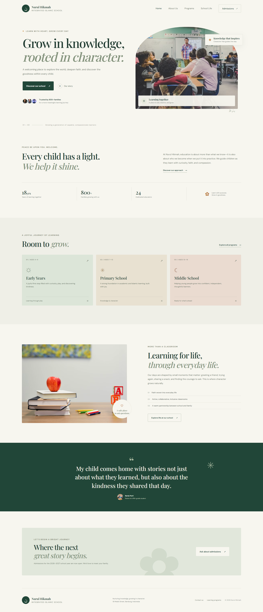

# Madrasah Nurul Hikmah

A responsive landing page for a fictional Indonesian integrated madrasah. Built with plain HTML, CSS, and JavaScript—no build step or dependencies required.

## Preview



## Run locally

Open `index.html` directly in a browser, or serve this directory with any static file server. For example:

```bash
python -m http.server 8000
```

Then visit `http://localhost:8000`.

## Files

- `index.html` — page structure and English landing-page content
- `styles.css` — responsive layout, typography, and visual design
- `script.js` — mobile navigation and dynamic copyright year
- `assets/madrasah-full-page.png` — full-page desktop preview

The page uses Google Fonts and photo URLs from Unsplash, so an internet connection is needed to load those assets.
